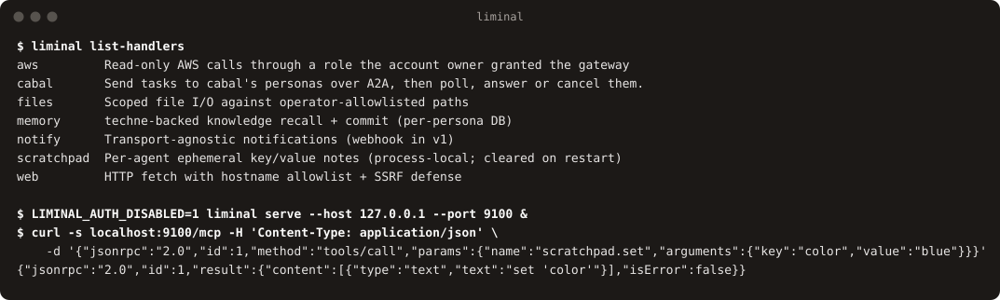

# liminal

liminal is an MCP gateway: one MCP connection per agent, many tool handlers behind it.

[](https://github.com/tenishai/liminal/actions/workflows/test.yml)
[](https://github.com/tenishai/liminal/releases)
[](LICENSE)
[](#status)



## Overview

From Latin *limen*, "threshold." liminal is the boundary an agent crosses to
reach its tools: memory, web fetch, file I/O, notifications, and persona-specific
backends. Instead of every agent running N MCP server processes, agents connect
to one liminal and liminal dispatches.

- **One MCP connection per agent**, not N.
- **Credentials per persona.** liminal fetches the credential set for
  `(persona, handler)` when a call is dispatched. No `.env` files on disk.
- **The operator's config is the ceiling.** A caller's token can narrow allowed
  paths, hosts and webhooks; it cannot widen them.
- **One handler interface.** In-process Python handlers and upstream MCP servers
  (`liminal serve --targets`) sit behind the same endpoint.
- **Every call is audited.** Each `tools/call` that reaches a handler logs one line.

liminal is the tool gateway in the tenish family of open-source platform and agent
projects, and runs without any of the others: with auth off it needs no issuer, and
any issuer can stand in for cabal if it signs RS256 tokens carrying `iss`, `aud`,
`exp`, `iat`, `sub`, a `persona` (or `cabal_persona`) claim and, in single-cabal mode,
a `scope` array containing `dispatch`.
[techne](https://github.com/tenishai/techne) backs the `memory` handler,
[cabal](https://github.com/tenishai/cabal) mints the tokens liminal verifies and
serves per-persona secrets, [daedalus](https://github.com/tenishai/daedalus) agents
use liminal as their tool provider, [kobo](https://github.com/tenishai/kobo) writes
agents' grants and reads the call audit, and
[gojira](https://github.com/tenishai/gojira) deploys it.

New here, or asking an agent what this is? Run `liminal guide welcome`: it ships in
the package and covers every mode, handler and extra with why you'd pick it.

## Quickstart

You need git and Python 3.12 or newer (on Debian and Ubuntu, `python3-venv` too).

```bash
git clone https://github.com/tenishai/liminal.git && cd liminal
python3 -m venv .venv
source .venv/bin/activate
pip install -e ".[dev]"
liminal list-handlers
```

Serve the handlers on one endpoint, auth off, for a single operator on localhost:

```bash
LIMINAL_AUTH_DISABLED=1 liminal serve --host 127.0.0.1 --port 9100
```

Then point a client at it, for example Claude Code:

```bash
claude mcp add --transport http liminal http://127.0.0.1:9100/mcp
```

`scratchpad` and `web` work straight away. `notify` needs `LIMINAL_NOTIFY_WEBHOOK_URL`,
`files` refuses every call until you grant it paths, and `memory` needs techne and
`LIMINAL_MEMORY_DB`; `curl http://127.0.0.1:9100/healthz` flags the last two as
`unconfigured`. [docs/running.md](docs/running.md) covers those
grants, JWT auth for production and deploying through gojira;
[docs/install.md](docs/install.md) covers the `memory` extra and the image.

## How it works

The endpoint speaks JSON-RPC at `POST /mcp` (`initialize`, `tools/list`, `tools/call`).
Handlers are discovered from installed packages through the `liminal.handlers` entry
point, and each tool is named `<handler>.<tool>`. In production liminal verifies the
caller's RS256 JWT: against one cabal's keys (`--jwks-url`), or, in sovereign mode
(`--trust-registry` with `--policy-db`), against several issuers with access coming
from a server-side grant per `(issuer, persona)`.

```
src/liminal/
  protocol/        Handler Protocol, Context, ToolSpec, ToolResult, CapabilityCard
  registry/        Entry-point discovery + handler registration
  dispatch/        Multiplexer (handlers + federated targets), in-process dispatcher
  server/          MCP HTTP server (POST /mcp), JWT verifiers, credential resolver,
                   policy store, admin surface, secret guard
  target/          Federated targets — the machinery behind `--targets`
  handlers/        scratchpad, files, web, memory, notify, aws, cabal
  client/          LiminalClient protocol, LibraryLiminalClient (in-process),
                   ProxyLiminalClient (HTTP, wraps AsyncMCPClient), from_config,
                   MCPClient (sync) + AsyncMCPClient (async)
  docs/            The guides `liminal guide` prints (welcome.md), shipped in the wheel
  wire.py          Wire-format helpers shared by the server and the library client
scripts/           check-techne-sibling.sh (sibling techne matches the pinned tag),
                   check_arch_cards.py (cards match the files they anchor)
tests/             pytest suite
docs/
  design.md        The ORIGINAL proposal. The implementation has diverged —
                   read what-works.md for what shipped.
  writing-a-handler.md  What a handler author needs beyond the sketch below
  arch/            Architecture cards, one per seam (indexed in ARCHITECTURE.md)
  proposals/       Design notes, not documentation of current behaviour
```

### Wiring a handler

```python
from liminal.protocol import Context, Handler, ToolResult, ToolSpec

# No base class: `Handler` is a typing.Protocol, so conforming is structural.
# None of the shipped handlers subclass it; the import is for the return type.
class GreetHandler:
    def tools(self) -> list[ToolSpec]: ...
    def capability_card(self) -> dict: ...
    async def dispatch(self, name: str, payload: dict, ctx: Context) -> ToolResult:
        return ToolResult.text(f"Hello, {payload['name']}!")

def get_handler() -> Handler:
    return GreetHandler()
```

Register via `pyproject.toml`:

```toml
[project.entry-points."liminal.handlers"]
greet = "mypackage.greet:get_handler"
```

That's the mechanism. Before you write a real handler, read
[`docs/writing-a-handler.md`](docs/writing-a-handler.md) — the things
(`ctx.extra`'s security contract, the optional `startup`/`shutdown`/`status`
hooks, silent discovery failure, a scope-gating footgun, the testing convention) that this sketch doesn't cover and that
you'd otherwise have to find in source.

### Using the MCP client

```python
from liminal.client import AsyncMCPClient

async with AsyncMCPClient(
    base_url="http://127.0.0.1:9100",   # wherever `liminal serve` is listening
    token_provider=lambda: my_token(),
) as client:
    tools = await client.list_tools()
    result = await client.call_tool("scratchpad.set", {"key": "color", "value": "blue"})
```

## Status

Pre-alpha. Seven built-in handlers ship (`scratchpad`, `files`, `web`, `memory`, `notify`,
`aws`, `cabal`; `docs/design.md` plans more, such as `slack` and `github`, and none
exist). The call audit, JWT auth in single-cabal and sovereign modes, revocation, the
credential flow, federated targets and the sync and async client library all work.
Network, DNS, file and SQLite work is awaited or run in a worker thread, and the
gateway is SSRF-hardened. [docs/what-works.md](docs/what-works.md) has each of these in
detail. Run `pytest -q` for the current suite (1053 passed, 2 skipped on 2026-11-23 at
3e3ac92, Python 3.12, `pip install -e ".[dev]"`, techne not installed: the
memory-handler module skips).

Not yet: the distribution (`tenish-liminal`) is not on PyPI, so installs come from a
clone or a git tag; `notify` has a generic webhook transport (it POSTs a fixed
JSON body) and a stdout one behind `LIMINAL_NOTIFY_STDOUT=1`; there are no Slack, Discord or
email transports.

## Documentation

- `liminal guide welcome`: the guide that ships in the package
- [docs/running.md](docs/running.md): `liminal serve`, its environment, auth, and deploying through gojira
- [docs/install.md](docs/install.md): clean-machine install, the `memory` extra, building the image
- [docs/what-works.md](docs/what-works.md): what the gateway does today, feature by feature
- [docs/writing-a-handler.md](docs/writing-a-handler.md): what a handler author needs to know
- [docs/cabal-handler.md](docs/cabal-handler.md): the `cabal` handler
- [ARCHITECTURE.md](ARCHITECTURE.md) and [docs/arch/](docs/arch/): a map of the code, for people and coding agents
- [docs/design.md](docs/design.md): the original proposal; the implementation has diverged
- [CHANGELOG.md](CHANGELOG.md): releases
- [SECURITY.md](SECURITY.md): how to report a vulnerability

## Contributing

Issues and pull requests are welcome. [CONTRIBUTING.md](CONTRIBUTING.md) has the setup,
the checks CI runs and the sign-off every commit needs; the
[Code of Conduct](CODE_OF_CONDUCT.md) applies to everyone taking part.

## How this was built

tenishai is a small team of engineers who build with AI coding agents. Most of
this code was written in pairing sessions with Claude models in Claude Code: a
person set the design, directed the work and reviewed what landed, and the
agent wrote much of the code and docs. Many commits name the agent in a
`Co-Authored-By:` trailer, either a Claude model or the name of the
agent one of us pairs with. A commit without a trailer may still
have had AI help.

## License

Copyright (c) 2026 tenish and the liminal contributors

MIT. See [LICENSE](LICENSE).
