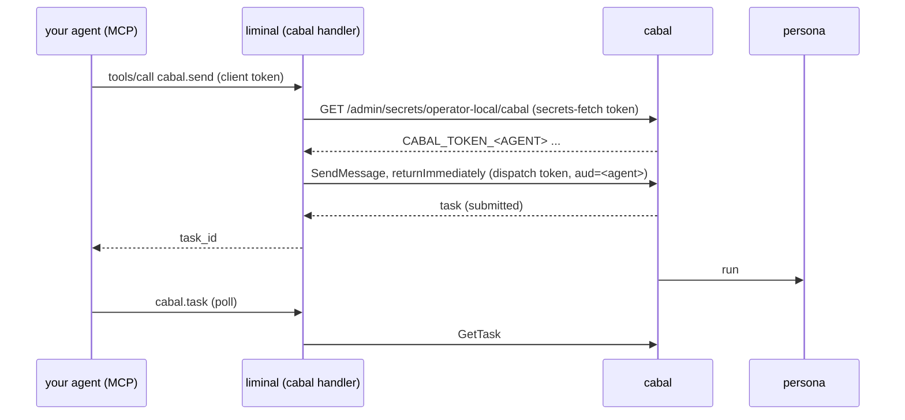

# The cabal handler: send work to cabal from your own agent

The `cabal` handler (liminal#189) lets a person's local coding agent (Claude Code,
goose, pi) send tasks to cabal's personas over MCP, then poll, answer and cancel
them. Those agents speak MCP, not A2A; the handler makes the A2A v1.0 calls to
`POST {cabal}/agents/{agent}/a2a` for them.

| Tool | A2A call | What it does |
|---|---|---|
| `cabal.agents` | GET agent cards | The personas you hold a token for, with each card's description |
| `cabal.send` | SendMessage, `returnImmediately` | Sends a task, returns its id at once. `group` queues it to the next idle member |
| `cabal.task` | GetTask | State, last status message, artifacts |
| `cabal.tasks` | ListTasks | Your tasks on a persona; filter by `context_id` or `state` |
| `cabal.inbox` | ListTasks, `input-required`, every persona | The tasks waiting on you, each with the agent's question, newest first |
| `cabal.answer` | SendMessage with `taskId` | Answers an `input-required` task: it goes back in the queue (cabal issues 423 and 145) |
| `cabal.cancel` | CancelTask | Cancels a running task |



## Two kinds of token

- **The client token** is what your agent presents to liminal. Its persona
  (`operator-local` below) is whose credential set liminal fetches, and its
  `--allowed-handler cabal` means `tools/list` shows your agent the `cabal.*`
  tools and nothing else (liminal's memory and search tools overlap what techne
  already gives it).
- **One dispatch token per persona** you may call, minted as an outside agent
  (cabal `docs/outside-agents.md`). They live in cabal's encrypted store under
  `(operator-local, cabal)`, one key each: `CABAL_TOKEN_<AGENT>`, the agent's
  bulletin name in upper snake (`wright-secundus` → `CABAL_TOKEN_WRIGHT_SECUNDUS`).
  That set is your grant: `cabal.agents` lists exactly these, and the handler
  never sends with any other.

All of them share one subject, `agent:ext-operator-local`, so one revoke stops
the lot.

## Set up

Run these against the cabal whose personas you want (`CABAL_HOME` and
`CABAL_URL` pointing at it, with an operator login).

1. The client token:

   ```sh
   cbl token mint-service --sub agent:ext-operator-local --persona operator-local \
     --scope dispatch --aud liminal --allowed-handler cabal --ttl-days 90 > client.jwt
   ```

2. For each persona you may call:

   ```sh
   cbl token mint-service --sub agent:ext-operator-local --scope dispatch \
     --aud wright-secundus --ttl-days 90 > wright-secundus.jwt
   cbl secret set operator-local cabal CABAL_TOKEN_WRIGHT_SECUNDUS
   ```

   `secret set` without `--value` prompts with hidden input, so the token stays
   out of shell history and `ps`; paste the file's contents there.

   `--aud` is the persona's dispatch audience, which is its bulletin name for a
   persona this cabal runs. ergon registers its agents as `federated` rows, so
   for an ergon set the audience is the row's `federation_audience`,
   `ergon-<set>-<agent>` (the wright set's `wright-secundus` is
   `ergon-wright-wright-secundus`). With the bare name cabal refuses the send:
   `token aud='wright-secundus' cannot dispatch to 'wright-secundus' (requires
   operator or colleague scope)`. The secret key stays the bulletin name,
   `CABAL_TOKEN_WRIGHT_SECUNDUS`.

   To send to a cabal group (`send` with `group`), hold a token for any one
   member and name it as `agent`; cabal starts the task on whichever member is
   idle.

   If the cabal sets `[guardrails] delegation_edges = true`, add
   `"agent:ext-operator-local" = ["<persona>", ...]` under
   `[guardrails.caller_edges]`, or every send is refused.

3. liminal must verify cabal's tokens and fetch credentials from it:

   ```sh
   LIMINAL_CABAL_TOKEN="$(cbl token mint-service --scope secrets-fetch)" \
   liminal serve --port 19720 \
     --jwks-url "$CABAL_URL/.well-known/jwks.json" --issuer cabal-core --audience liminal \
     --cabal-url "$CABAL_URL"
   ```

   The handler sends its A2A calls to `--cabal-url` (env `LIMINAL_CABAL_URL`)
   unless `LIMINAL_CABAL_A2A_URL` names another address. `LIMINAL_CABAL_A2A_TIMEOUT`
   sets seconds per call (default 30).

4. Point your agent at liminal. For Claude Code:

   ```sh
   claude mcp add --transport http cabal http://127.0.0.1:19720/mcp \
     --header "Authorization: Bearer $(cat client.jwt)"
   ```

## Inbox: hear when an agent asks you something

An agent that needs you ends its turn with the task in `input-required` and its
question as the status message. `cabal.inbox` lists every such task you sent,
across all the personas you hold a token for. It reads cabal's state, not
notifications, so a missed hook or a restart loses nothing. A group task shows
once, whichever member asked (it needs cabal PR 446).

`contrib/claude-code/cabal_inbox_hook.py` puts that list in front of a Claude
Code session. At session start it prints everything waiting. On each prompt it
prints only tasks this session hasn't been told about yet. It needs Python 3.11
or later and nothing else, and it never blocks the session: on any failure it
prints nothing.

```toml
# ~/.config/liminal/cabal-inbox.toml (or CABAL_INBOX_URL / _TOKEN_FILE / _TIMEOUT)
url = "http://127.0.0.1:19720/mcp"
token_file = "~/.config/liminal/client.jwt"
```

```json
{
  "hooks": {
    "SessionStart": [{ "hooks": [{ "type": "command", "command": "python3 /path/to/liminal/contrib/claude-code/cabal_inbox_hook.py", "timeout": 10 }] }],
    "UserPromptSubmit": [{ "hooks": [{ "type": "command", "command": "python3 /path/to/liminal/contrib/claude-code/cabal_inbox_hook.py", "timeout": 10 }] }]
  }
}
```

Set `CABAL_INBOX_DEBUG=1` to have it say on stderr what it did.

## Revoke

```sh
curl -X POST "$CABAL_URL/admin/token/revoke" -H "Authorization: Bearer $OPERATOR_TOKEN" \
  -H "Content-Type: application/json" -d '{"sub": "agent:ext-operator-local"}'
```

Every dispatch token stops at cabal at once: each `cabal.*` call then fails with
`HTTP 401 ... was revoked`. liminal started with `--cabal-url` refuses the client
token too, within its refresh window (`--revocation-ttl`, 30s by default), provided
cabal serves `GET /auth/revocations`. An older cabal answers 404 there, and then the
client token still opens liminal, and `tools/list` still answers, until it expires;
keep its TTL short.

## Behaviour worth knowing

- **Fire-and-collect.** `send` never waits for the work. A task can run for
  hours; poll `cabal.task`.
- **Uncertain sends.** If the request may have reached cabal but no reply came
  back (read timeout, dropped connection, a 5xx), `send` returns
  `outcome: "uncertain"` with the `context_id` it sent. Call
  `cabal.tasks(agent, context_id)` before sending again: a task in that context
  means it arrived. A refused connection is a plain failure, since nothing left
  the host.
- **Cards.** `cabal.agents` reads each persona's v1.0 card for its description.
  A cabal without `public_url` serves no cards; the persona is still listed,
  with a `card_error`, and every other tool works.
